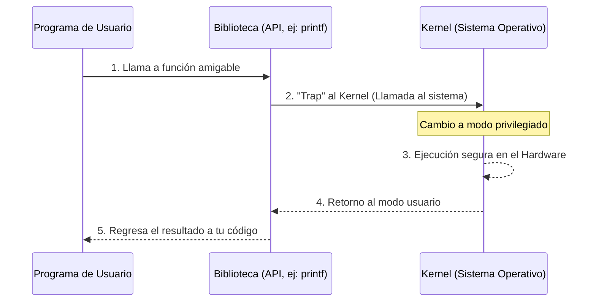

import SimuladorStrace from '@site/src/components/SimuladorStrace';

**Idea central:** Una llamada al sistema es la única forma legal y segura en la que un programa común puede pedirle favores al sistema operativo (como usar la pantalla, el disco duro o el internet), evitando que los programas toquen el hardware directamente y causen un desastre.

### Desarrollo y Conceptos Básicos

Imagina que tu computadora es un restaurante exclusivo. Tu programa es el cliente sentado en la mesa y el Hardware (el disco duro, la pantalla) es la cocina. El cliente no puede entrar corriendo a la cocina a preparar su propia comida por temas de seguridad y orden. La **llamada al sistema (System call)** es el mesero: tú le pides algo, él entra a la cocina (el Kernel), lo prepara, y te trae el resultado. 

Si un programa de usuario tocara el hardware directamente, un error en tu código podría borrar el disco duro o colgar toda la máquina. Para evitarlo, el procesador tiene un "modo usuario" (con permisos limitados) y un "modo kernel" (con control total). 

**¿Qué es una API frente a una llamada al sistema?**
Para nosotros como programadores, escribir llamadas al sistema crudas (como `write`) es muy tedioso y complicado. Por eso usamos APIs (Interfaces de Programación de Aplicaciones) como `printf`. La API es una función amigable y fácil de usar; tú simplemente escribes `printf("Hola")`, y detrás de escena, esa API se encarga de traducir eso a la llamada al sistema compleja (`write`) que el sistema operativo sí entiende.

### Categorías de Llamadas al Sistema

| Categoría | ¿Para qué sirve? | Ejemplos reales en Linux |
| :--- | :--- | :--- |
| **Control de procesos** | Crear, pausar o matar programas en ejecución. | `fork()`, `exit()`, `wait()` |
| **Manejo de archivos** | Crear, leer, escribir o borrar archivos del disco. | `open()`, `read()`, `write()` |
| **Manejo de dispositivos** | Pedirle acceso al hardware, como la cámara o USB. | `ioctl()`, `read()` |
| **Información del sistema** | Preguntarle la fecha, hora, o datos de la computadora. | `getpid()`, `time()` |
| **Comunicación** | Mandar datos por red o hablar con otros programas. | `pipe()`, `shmget()`, `mmap()` |

### Diagrama de recorrido (API vs Kernel)



### Ejemplo de Código en C

En este código vamos a saltarnos la API amigable y vamos a usar la llamada al sistema directamente.

```c
#include <unistd.h>
#include <string.h>

int main(void) {
    const char *msg = "Hola desde write()\n";
    write(1, msg, strlen(msg)); // llamada directa al sistema, fd 1 = stdout
    return 0;
}
```

**Explicación línea por línea:**
1. Traemos las bibliotecas `unistd.h` (que contiene las herramientas del sistema) y `string.h` (para manejar textos).
2. Abrimos la función principal `main()`.
3. Preparamos el mensaje de texto que queremos imprimir en una variable constante llamada `msg`.
4. ¡Aquí ocurre la magia! Usamos la llamada cruda `write`. Le pasamos tres instrucciones: 
   * `1`: Le indicamos que el destino es la pantalla (conocida como salida estándar o stdout).
   * `msg`: Le pasamos nuestro texto.
   * `strlen(msg)`: Le decimos exactamente cuántos caracteres tiene que dibujar en pantalla.
5. `return 0`: Le avisamos al sistema que el programa terminó sin errores.

### Experimento práctico con `strace`

Al hacer este experimento en la terminal de Linux, compilé el programa (`gcc ejemplo.c -o ejemplo`) y luego lo ejecuté usando una herramienta espía llamada `strace`. 

Lo que vi fue sorprendente: aunque el programa solo tiene 5 líneas de código, Linux ejecutó un montón de llamadas al sistema ocultas (como `execve` para preparar la memoria, o `mmap`). Hasta el final, apareció mi llamada `write(1, "Hola desde write()\n", 19)` que imprimió el texto, seguida por un `exit_group` para matar el proceso. Esto demuestra que hasta el programa más simple requiere muchísimo apoyo del sistema operativo para poder existir.

**¡Mira cómo se ve el experimento en vivo!**
Haz clic en el botón para simular el análisis de nuestro código C:

<SimuladorStrace />

### Puntos Clave
* Los programas normales viven encerrados en el "modo usuario". No pueden tocar el hardware para evitar daños al equipo.
* La **Llamada al Sistema** es el puente oficial y seguro para cruzar al "modo kernel" y pedirle al sistema operativo que maneje el hardware por nosotros.
* Usamos APIs porque son fáciles y universales, pero internamente, siempre terminan ejecutando una llamada al sistema específica del sistema operativo donde estemos.