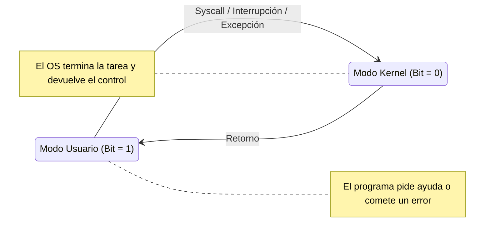

import SimuladorProteccion from '@site/src/components/SimuladorProteccion';

**Idea central:** El modo dual es el sistema de seguridad VIP de la computadora; divide el mundo en dos zonas para garantizar que ningún programa común (como un videojuego o un navegador) pueda meterse con las piezas críticas del sistema y causar un desastre.

### El Modo Usuario vs Modo Kernel

Para entenderlo fácilmente, imagina que tu computadora es un avión. El **Modo Usuario** es la cabina de pasajeros: ahí viven todos tus programas diarios. Los pasajeros pueden ver películas, comer y caminar, pero no pueden tocar los controles del avión. El **Modo Kernel** es la cabina de los pilotos: solo el Sistema Operativo tiene la llave para entrar ahí y dar órdenes directas a los motores (el hardware).

¿Cómo sabe el procesador en qué cabina está? Usa un pequeño interruptor interno llamado **Bit de Modo**. Si el bit está en `1`, el procesador está en Modo Usuario (restringido). Si el bit cambia a `0`, está en Modo Kernel (con poder absoluto). Las tareas peligrosas, como borrar todo un disco duro, se llaman **instrucciones privilegiadas**. Si un pasajero (un programa normal) intenta ejecutar una instrucción privilegiada, el sistema lo detecta y lo cancela inmediatamente.

### Los 3 Mecanismos de Protección

El sistema operativo es desconfiado por naturaleza y usa tres muros de seguridad para mantener el orden[cite: 8]:

1. **Protección de Memoria:** Es como ponerle bardas a los terrenos. El sistema se asegura de que el programa A no pueda asomarse ni escribir en la porción de memoria RAM que le pertenece al programa B, y mucho menos en la memoria del Kernel[cite: 8].
2. **Protección de CPU (Temporizador):** Evita que un programa egoísta acapare todo el procesador. El sistema le pone un "cronómetro" (temporizador) a cada programa[cite: 8]. Si el tiempo se acaba, el procesador le quita el control a la fuerza y se lo pasa a otro programa. Así la compu no se congela por completo si una app se traba.
3. **Protección de Entrada/Salida (E/S):** Ningún programa puede hablar directamente con la pantalla, el teclado o el disco duro. Todo acceso a estos periféricos requiere permisos y se debe pedir "por favor" a través del Kernel[cite: 8].

### Cuadro Comparativo

| Característica | Modo Usuario (Bit 1) | Modo Kernel (Bit 0) |
| :--- | :--- | :--- |
| **Nivel de Acceso** | Restringido. No puede tocar el hardware[cite: 8]. | Total y absoluto. Controla todos los recursos del equipo[cite: 8]. |
| **Instrucciones** | Solo instrucciones seguras y matemáticas básicas[cite: 8]. | Puede ejecutar **instrucciones privilegiadas**[cite: 8]. |
| **¿Quién corre aquí?** | Navegadores, juegos, editores de texto, tus scripts[cite: 8]. | El núcleo del Sistema Operativo y los drivers[cite: 8]. |
| **¿Qué pasa si falla?** | La aplicación se cierra o da error, pero la compu sigue viva[cite: 8]. | Toda la computadora colapsa (Pantallazo Azul en Windows o Kernel Panic en Linux)[cite: 8]. |

### Diagrama de Estados: El viaje entre modos

Este diagrama muestra cómo un programa salta de un modo a otro. Normalmente estás en modo usuario, pero si necesitas leer un archivo (System Call) o hay un error, el sistema salta al modo Kernel, hace el trabajo, y regresa[cite: 8].



### Ejemplo de Código: Intentando romper las reglas (C)

¿Qué pasa cuando un programa intenta ser listo y acceder a algo prohibido? Veamos este ejemplo en lenguaje C, donde intentamos modificar una zona de la memoria que no nos pertenece (apuntando al valor `NULL` o 0).

```c
#include <stdio.h>

int main() {
    printf("Soy un programa normal arrancando...\n");
    
    // Un puntero apuntando a la dirección de memoria 0 (restringida)
    int *memoria_prohibida = NULL; 
    
    // Intentamos escribir en esa memoria a la fuerza
    *memoria_prohibida = 99; 
    
    printf("Esta línea nunca se va a imprimir.");
    return 0;
}
```

**Explicación del código:** Cuando ejecutas esto, el procesador (que está en Modo Usuario con el bit en 1) se da cuenta de que la dirección `NULL` es inválida o está fuera de los límites permitidos para este programa. Inmediatamente genera una "excepción" (una alerta roja). El sistema operativo toma el control, detiene el programa a la fuerza y lanza un error llamado *Segmentation fault* (violación de segmento).

**¡Haz la prueba tú mismo!**
Presiona el botón para compilar y ejecutar nuestro programa rebelde, y observa cómo el Kernel entra en acción para aniquilar la amenaza:

<SimuladorProteccion />

### Puntos Clave
* El **bit de modo** (0 o 1) es el policía de tránsito que le dice al procesador si está obedeciendo al dueño de la máquina (Kernel) o a un invitado (Usuario).
* Si estás jugando Valheim y el juego tiene un bug grave, la protección de memoria y CPU aseguran que solo se cierre el juego, pero tu sistema operativo siga funcionando con normalidad.
* Sin el modo dual, cualquier error en el código de un estudiante de primer semestre podría apagar la computadora o quemar un disco duro.