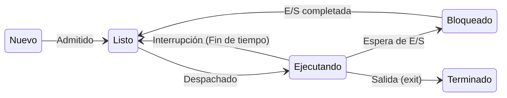

import ProcessSimulator from '@site/src/components/ProcessSimulator';

**Idea central:** Un programa es solo un montón de código muerto guardado en tu disco duro; cuando le haces doble clic, el Sistema Operativo lo despierta, lo sube a la memoria RAM y lo convierte en un "proceso", un ente vivo que pasa por diferentes estados de ánimo hasta que lo cierras.

### Programa vs Proceso

Para entenderlo fácil, piensa en tu computadora cuando vas a jugar Valheim. 

Mientras no estás jugando, los archivos de Valheim están guardados en tu disco de estado sólido. Ahí, el juego es un **programa**: un ente pasivo, inerte, que no hace nada. Pero cuando vas a Steam y le das al botón de "Jugar", el Sistema Operativo agarra esos archivos, los carga en la memoria RAM y les asigna espacio. En ese instante mágico, el programa se transforma en un **proceso**: ahora está vivo, consumiendo recursos y peleando por la atención del procesador.

### Los 5 Estados de un Proceso

Durante su vida, un proceso salta entre cinco estados diferentes:
1. **Nuevo:** El proceso se acaba de crear, pero el SO todavía no lo sube a la memoria principal.
2. **Listo:** Ya está en la RAM, cruzado de brazos, esperando su turno para usar el procesador.
3. **Ejecutando:** ¡Su momento de brillar! El procesador está leyendo y ejecutando su código.
4. **Bloqueado:** El proceso está trabado esperando que pase algo externo (como que el usuario mueva el mouse o cargue un archivo del disco). No usa el procesador, solo espera.
5. **Terminado:** El proceso completó su tarea o fue cerrado a la fuerza.

### Tabla de Transiciones

¿Cómo se mueve un proceso de un estado a otro? No es magia, siempre hay un evento y un responsable:

| Estado Origen | Estado Destino | Evento que lo provoca | ¿Quién dispara el evento? |
| :--- | :--- | :--- | :--- |
| **Nuevo** | **Listo** | Se admite al proceso en la RAM. | El **Planificador** (Admisor). |
| **Listo** | **Ejecutando** | Se le asigna un núcleo libre del CPU. | El **Despachador** (Dispatcher). |
| **Ejecutando** | **Listo** | Se le acabó su "rebanada de tiempo". | Interrupción por **Hardware** (Reloj). |
| **Ejecutando** | **Bloqueado** | Pide leer un archivo o espera el teclado. | El **Propio proceso** (llamada al sistema). |
| **Bloqueado** | **Listo** | El disco terminó de cargar el archivo. | Interrupción por **Hardware** (E/S lista). |
| **Ejecutando** | **Terminado** | Llega a su fin o hay un error fatal. | El **Propio proceso** (llama a `exit`). |

### Diagrama de Estados

Aquí puedes ver el camino que sigue. Fíjate que de "Bloqueado" nunca regresas a "Ejecutando" de golpe; tienes que formarte en la fila de "Listo" otra vez.



### Ejemplo de Código (Simulando un Bloqueo en Python)

Este script muy sencillo en Python muestra un proceso pasando a estado **Bloqueado** a propósito.

```python
import time

print("1. [Ejecutando] Iniciando cálculo complejo...")

# Al usar time.sleep(), el proceso dice: "SO, no voy a hacer nada por 3 segundos".
# El proceso se mueve a estado BLOQUEADO voluntariamente.
# El procesador queda libre para atender a otro programa.
time.sleep(3) 

# Cuando el reloj de hardware avisa que pasaron los 3 segundos,
# el proceso vuelve a LISTO, y cuando el CPU está libre, se Ejecuta esto:
print("2. [Ejecutando] Desperté, terminando el cálculo.")
```

### ¡Sé el Sistema Operativo! (Simulador)

Usa los botones de abajo para gobernar el ciclo de vida de un proceso siguiendo las reglas de nuestra tabla. Fíjate cómo los botones cambian según el estado.

<ProcessSimulator />

### Puntos Clave
* La diferencia fundamental es que el programa es estático (disco) y el proceso es dinámico (RAM).
* El procesador es muy valioso para estar ocioso. Si un proceso tiene que esperar por el disco duro, el SO lo pasa a **Bloqueado** para darle el CPU a un proceso que esté **Listo**.