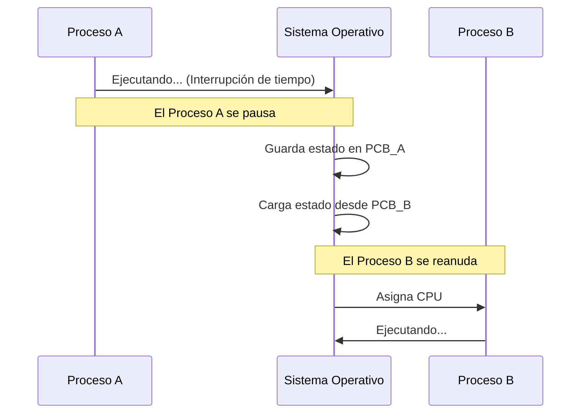

import SimuladorPCB from '@site/src/components/SimuladorPCB';

**Idea central:** El PCB es como el "documento de identidad" y la "partida guardada" de un proceso; es una estructura de datos donde el Sistema Operativo anota todo lo que está haciendo un programa para poder pausarlo y reanudarlo más tarde sin que pierda su progreso.

### ¿Qué es el PCB y por qué existe?

Imagina que estás leyendo un libro muy interesante, pero alguien te interrumpe. Para no perderte, pones un separador en la página exacta, anotas en qué párrafo te quedaste y cierras el libro. Cuando vuelves, revisas tu separador y sigues leyendo exactamente desde donde lo dejaste. 

El **Bloque de Control de Proceso (PCB)** hace exactamente eso. Si el PCB no existiera, el Sistema Operativo no podría pausar un programa para darle tiempo a otro. Al pausarlo, olvidaría en qué línea de código iba, qué variables tenía en la memoria o qué archivos estaba usando, obligando al programa a empezar desde cero cada vez.

### ¿Qué información guarda el PCB?

Para que un proceso se pueda reanudar a la perfección, el PCB guarda detalles críticos:

* **PID (Process ID):** Su número de identificación único (como un DPI o número de carnet universitario).
* **Estado del proceso:** Si está Nuevo, Listo, Ejecutando o Bloqueado.
* **Contador de Programa (Program Counter):** La dirección de la próxima línea de código que debe ejecutarse. Es el "separador del libro".
* **Registros de CPU:** Los cálculos temporales que estaba haciendo el procesador justo antes de ser pausado.
* **Información de planificación:** Su nivel de prioridad. (Por ejemplo, un proceso del sistema tiene más prioridad que un reproductor de música).
* **Gestión de memoria y archivos:** Cuánta RAM está usando y qué archivos tiene abiertos actualmente.

### El Cambio de Contexto (Context Switch)

El cambio de contexto es la maniobra en la que el procesador deja de ejecutar el Proceso A para empezar a ejecutar el Proceso B. 

Para que esto suceda de forma segura, el Sistema Operativo tiene que intervenir:
1. Pone en pausa al Proceso A.
2. **Guarda** todo el estado actual de la CPU en el PCB del Proceso A.
3. Busca al Proceso B en la fila de espera.
4. **Carga** la información que estaba guardada en el PCB del Proceso B hacia la CPU.
5. Reanuda el Proceso B desde donde se había quedado.

### Diagrama de Cambio de Contexto

Este diagrama ilustra cómo la CPU nunca deja de trabajar, mientras que los procesos y el Sistema Operativo interactúan mediante los PCBs.



### Ejemplo en C: Modelando un PCB

Como programadores, estructurar esto es muy lógico. Si tuviéramos que construir un Sistema Operativo básico en lenguaje C, usaríamos un `struct` para empaquetar toda la información de un proceso junta.

```c
#include <stdio.h>

// Definimos la estructura de nuestro PCB simplificado
struct PCB {
    int pid;                  // ID del proceso
    int estado;               // 0=Listo, 1=Ejecutando, 2=Bloqueado
    int program_counter;      // En qué línea de instrucción se quedó
    int registros[4];         // Variables temporales de la CPU
};

int main() {
    // Creamos el PCB para un nuevo proceso
    struct PCB proceso_navegador;
    
    proceso_navegador.pid = 1045;
    proceso_navegador.estado = 1; // Ejecutando
    proceso_navegador.program_counter = 2056; 
    
    printf("El proceso %d está en la instrucción %d\n", 
           proceso_navegador.pid, proceso_navegador.program_counter);
           
    return 0;
}
```
**Explicación del código:** Usamos un `struct` porque un proceso no es solo un número o solo un texto; es un conjunto de varios datos de diferente tipo que deben viajar juntos. Cuando el SO necesita guardar el estado, simplemente toma esta "caja" (`proceso_navegador`) y la almacena en la memoria hasta que sea su turno de nuevo.

### Simulación de Cambio de Contexto en Vivo

Haz clic en el botón para ver cómo el Sistema Operativo actúa como intermediario para quitarle el procesador a un programa y dárselo a otro usando los PCBs.

<SimuladorPCB />

### Puntos Clave
* Sin el PCB, la multitarea no existiría. Tu computadora solo podría hacer una sola cosa a la vez.
* El **Cambio de Contexto** requiere esfuerzo ("overhead"). Mientras el Sistema Operativo está ocupado guardando el PCB_A y cargando el PCB_B, la CPU no está ejecutando ningún programa útil para el usuario.