import CalculadoraQuantum from '@site/src/components/CalculadoraQuantum';

**Idea central:** Round Robin (Carrusel) es la forma más justa de repartir el procesador. En lugar de dejar que un programa acapare todo el tiempo, el Sistema Operativo le da a cada uno un turno muy cortito (el quantum). Cuando se acaba el turno, lo manda al final de la fila.

### ¿Qué es el Quantum y el Dilema del tiempo?

Imagina que estás con dos amigos y tienen una sola consola para jugar. Para que nadie se aburra, deciden que cada uno jugará exactamente 10 minutos y luego pasará el control al siguiente, haciendo una rueda infinita. Esos 10 minutos son el **Quantum**: la rebanada de tiempo máximo que un proceso puede usar el procesador de corrido[cite: 13].

Configurar el tamaño de ese quantum es el mayor dolor de cabeza para los diseñadores de Sistemas Operativos por este dilema[cite: 13]:

1. **Si el quantum es muy pequeño:** (Ej. 1 minuto). Se cambian los turnos tan rápido que pasan más tiempo guardando y cargando partidas (Cambio de Contexto) que jugando de verdad. A esto se le llama **sobrecarga** o desperdicio de CPU[cite: 13].
2. **Si el quantum es muy grande:** (Ej. 2 horas). La rueda gira tan lento que se convierte en un sistema *First Come, First Served* (FCFS)[cite: 13]. Si tu amigo agarra el control primero, te toca esperar horas para jugar, dando una **mala respuesta** al usuario[cite: 13].

### Prueba el dilema en vivo

Usa esta calculadora para ver matemáticamente cómo un quantum muy corto arruina el rendimiento de la CPU por culpa de la lentitud de los cambios de contexto.

<CalculadoraQuantum />

### Ejercicio Resuelto: 3 Procesos (Quantum = 4)

Vamos a simular matemáticamente cómo la CPU atiende a tres programas que llegan al mismo tiempo (en el milisegundo 0), con un **Quantum de 4 ms**[cite: 13].

| Proceso | Tiempo de Ráfaga (Total necesario) |
| :--- | :--- |
| **P1** | 10 ms |
| **P2** | 5 ms |
| **P3** | 8 ms |

#### Diagrama de Gantt (Línea de ejecución)

El procesador atiende máximo 4 ms a cada uno. Si el proceso necesita menos, suelta la CPU temprano; si necesita más, se va al final de la fila[cite: 13].

```mermaid
gantt
    title Ejecución Round Robin
    dateFormat X
    axisFormat %s
    section CPU
    P1 (Q1) :a1, 0, 4
    P2 (Q1) :a2, 4, 8
    P3 (Q1) :a3, 8, 12
    P1 (Q2) :a4, 12, 16
    P2 (Q2) :a5, 16, 17
    P3 (Q2) :a6, 17, 21
    P1 (Q3) :a7, 21, 23
```

*Observa cómo P2 terminó en el milisegundo 17 porque solo necesitaba 1 ms en su segunda vuelta.*

#### Cálculo de Tiempo de Espera Promedio

Para saber cuánto tiempo *sufrió* cada proceso esperando en la fila sin hacer nada, usamos la fórmula matemática: 
`Tiempo de Espera = Tiempo Final - Llegada - Ráfaga Total`

*   **P1:** Terminó en 23. Llegó en 0. Su trabajo era 10.
    `P1 = 23 - 0 - 10 = 13 ms`
*   **P2:** Terminó en 17. Llegó en 0. Su trabajo era 5.
    `P2 = 17 - 0 - 5 = 12 ms`
*   **P3:** Terminó en 21. Llegó en 0. Su trabajo era 8.
    `P3 = 21 - 0 - 8 = 13 ms`

Finalmente, calculamos el promedio sumando los tres y dividiendo entre 3:

`Promedio = (13 + 12 + 13) / 3 = 38 / 3 = 12.67 ms`

### Puntos Clave
* Round Robin es el rey de los sistemas interactivos (como tu computadora personal), porque garantiza que ningún programa, por más pesado que sea, congele tu máquina impidiendo que muevas el mouse.
* Encontrar el tamaño perfecto del quantum es un arte: debe ser lo suficientemente grande para que el cambio de contexto no represente más del 10% del tiempo total, pero lo suficientemente pequeño para que la pantalla no se sienta "lagueada".