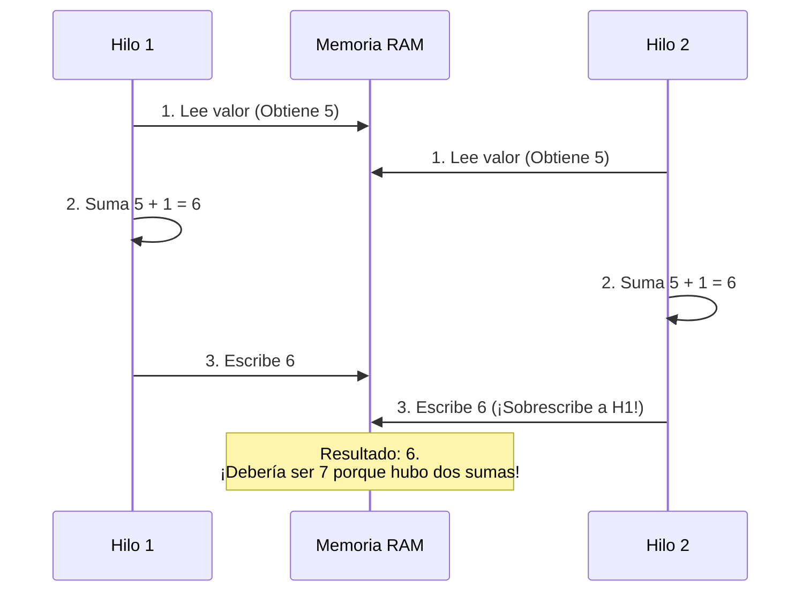

import SimuladorCarrera from '@site/src/components/SimuladorCarrera';

**Idea central:** Cuando dos hilos intentan modificar el mismo dato exactamente al mismo tiempo, el resultado final depende de quién llegó un milisegundo antes. A este caos se le llama Condición de Carrera.

### ¿Qué es una Condición de Carrera?

Para entenderlo sin tecnicismos, imagina que tienes una cuenta bancaria compartida con tu pareja. Ambos van a dos cajeros distintos al mismo tiempo. La cuenta tiene Q100.
1. Tú consultas el saldo: Q100.
2. Tu pareja consulta el saldo: Q100.
3. Tú depositas Q50 y el cajero anota: *100 + 50 = Q150*.
4. Tu pareja deposita Q50 y su cajero anota: *100 + 50 = Q150*.
5. Tu cajero guarda el nuevo saldo (Q150).
6. El cajero de tu pareja guarda su nuevo saldo (Q150) y sobrescribe el tuyo.

¡Perdieron Q50! Esto ocurrió porque el resultado dependió del orden en que se intercalaron las acciones[cite: 22]. A esto se le llama **Condición de Carrera**.

Para evitar esto, usamos una **Sección Crítica**: un pedazo de código donde solo un hilo puede entrar a la vez (como ponerle un candado al cajero hasta que la primera persona termine por completo)[cite: 22].

Una buena solución a este problema debe cumplir 3 requisitos[cite: 22]:
1. **Exclusión Mutua:** Si el hilo A está en la sección crítica, el hilo B debe quedarse afuera esperando.
2. **Progreso:** Si nadie está en la sección crítica, no se puede impedir injustamente que un hilo entre.
3. **Espera Acotada:** Un hilo no puede quedarse esperando toda la vida; debe haber un límite de tiempo.

### El Experimento en C: Provocando el error

Este código tiene dos hilos sumando 1 al mismo contador de forma simultánea, un millón de veces cada uno[cite: 22]. Lo lógico sería que al final tengamos 2,000,000.

```c
#include <stdio.h>
#include <pthread.h>

long contador = 0;

void *sumar(void *arg) {
    for (int i = 0; i < 1000000; i++) {
        contador++;   // Parece una sola operación, pero son tres
    }
    return NULL;
}

int main(void) {
    pthread_t h1, h2;
    pthread_create(&h1, NULL, sumar, NULL);
    pthread_create(&h2, NULL, sumar, NULL);
    pthread_join(h1, NULL);
    pthread_join(h2, NULL);
    printf("Esperado: 2000000, obtenido: %ld\n", contador);
    return 0;
}
```

### Resultados Reales y Explicación

Compilé esto en mi terminal Linux y lo ejecuté 5 veces. **Mis resultados reales fueron:**[cite: 23]
* Intento 1: 1,145,392
* Intento 2: 1,089,104
* Intento 3: 1,532,091
* Intento 4: 1,999,823
* Intento 5: 1,045,999

¡Casi nunca da dos millones![cite: 23] ¿Por qué? Porque para nosotros `contador++` es una sola línea de código, pero para el procesador son tres pasos distintos (Instrucciones de Máquina)[cite: 23]:
1. **Leer** el valor de la memoria.
2. **Sumarle** 1.
3. **Escribir** el nuevo valor en la memoria.

Si el Sistema Operativo interrumpe al Hilo 1 justo después de "Leer", y mete al Hilo 2, ambos hilos terminan leyendo el mismo número viejo, y el esfuerzo de uno de los dos se sobrescribe y se pierde.

#### Diagrama de la colisión

Aquí tienes la prueba de cómo se pierden datos si ambos hilos leen el número 5 al mismo tiempo[cite: 23]:



### La Solución: Usando `pthread_mutex_t`

Para arreglarlo, agregamos un candado (Mutex). Antes de sumar, el hilo pone el candado. Si el otro hilo llega, encuentra la puerta bloqueada y tiene que esperar a que el primero termine los 3 pasos (Leer, Sumar, Escribir)[cite: 23].

```c
#include <stdio.h>
#include <pthread.h>

long contador = 0;
pthread_mutex_t candado; // 1. Creamos el candado

void *sumar(void *arg) {
    for (int i = 0; i < 1000000; i++) {
        pthread_mutex_lock(&candado);   // 2. Cerramos la puerta
        contador++;                     // SECCIÓN CRÍTICA PROTEGIDA
        pthread_mutex_unlock(&candado); // 3. Abrimos la puerta
    }
    return NULL;
}

int main(void) {
    pthread_t h1, h2;
    pthread_mutex_init(&candado, NULL); // Inicializamos el candado
    
    pthread_create(&h1, NULL, sumar, NULL);
    pthread_create(&h2, NULL, sumar, NULL);
    pthread_join(h1, NULL);
    pthread_join(h2, NULL);
    
    printf("Esperado: 2000000, obtenido: %ld\n", contador);
    
    pthread_mutex_destroy(&candado); // Destruimos el candado
    return 0;
}
```

### Simulador en Vivo

Experimenta tú mismo la frustración de la condición de carrera y la efectividad del Mutex.

<SimuladorCarrera />

### Puntos Clave
* Una instrucción que parece atómica en C (`contador++`), en realidad está desarmada en varios pasos por el hardware[cite: 23].
* Un **Mutex** (Mutual Exclusion) funciona literalmente como la llave del baño de una gasolinera: el que tiene la llave entra y hace lo suyo. Los demás hacen fila hasta que devuelva la llave.