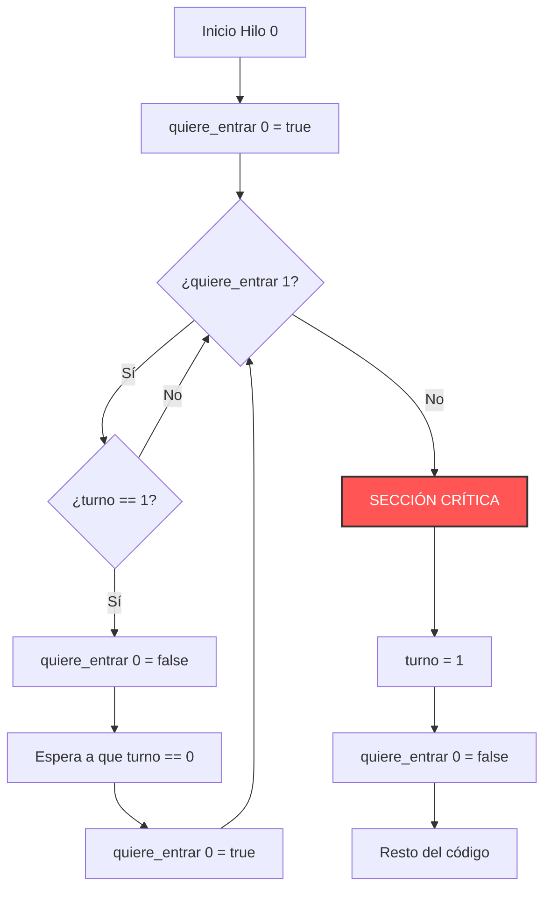

**Idea central:** Lograr la exclusión mutua por software es sumamente difícil. Veremos cómo Dekker llegó a la solución tras 4 intentos fallidos, y cómo Peterson logró lo mismo de una forma mucho más elegante.

## El Algoritmo de Dekker: Una historia de intentos fallidos

A principios de los años 60, el matemático T.J. Dekker inventó el primer algoritmo de exclusión mutua para dos procesos, pero no le salió a la primera. Las versiones 1 a 4 son intentos que solucionan un problema pero crean uno nuevo. 

Aquí analizamos por qué fallaron mediante **intercalaciones concretas** (qué pasa si el Sistema Operativo interrumpe a un hilo en el peor momento posible).

### Cuadro Comparativo: La evolución de Dekker

| Versión | Idea Principal | ¿Qué propiedad falla y por qué? (Intercalación fatal) |
| :--- | :--- | :--- |
| **V1** | Usar una variable `turno`. | **Falla el Progreso (Alternancia Estricta):** Si es el turno del Hilo 1, pero el Hilo 1 no necesita entrar a la sección crítica, el Hilo 2 jamás podrá entrar. Se quedan atascados aunque la sección esté libre. |
| **V2** | Banderas `quiere_entrar` (1 por hilo). Revisa la del otro y luego sube la suya. | **Falla la Exclusión Mutua:** H1 lee que H2 no quiere entrar. ¡*Interrupción de CPU*! H2 lee que H1 no quiere. Ambos suben su bandera y **ambos entran** al mismo tiempo. Colisión. |
| **V3** | Subir bandera *antes* de revisar la del otro. | **Falla el Progreso (Interbloqueo/Deadlock):** H1 sube bandera. *Interrupción*. H2 sube bandera. H1 mira a H2 y espera. H2 mira a H1 y espera. Ambos esperan por siempre. |
| **V4** | Subir bandera, si el otro la tiene, bajarla por un momento y reintentar. | **Falla la Espera Acotada (Livelock):** H1 y H2 suben bandera exactamente al mismo tiempo. Se ven. Ambos la bajan al mismo tiempo. Ambos esperan un milisegundo. Ambos la suben. Bailan infinitamente sin avanzar. |
| **V5** | Combina las Banderas y la variable de `turno`. | **Ninguna, es la correcta.** Las banderas muestran la intención, pero el `turno` rompe los empates. |

### Pseudocódigo de las versiones (Para Hilo 0)

Para entender mejor, veamos cómo se ve la estructura del código de los intentos fallidos frente a la versión final:

```c
// --- INTENTO V1 ---
while (turno != 0); // Espera activa
// SECCIÓN CRÍTICA
turno = 1; 

// --- INTENTO V3 (Provoca Deadlock) ---
quiere_entrar[0] = true;
while (quiere_entrar[1]); // Ambos se quedan atrapados aquí
// SECCIÓN CRÍTICA
quiere_entrar[0] = false;
```

### El Algoritmo de Dekker V5 (La Solución)

Dekker soluciona el Livelock de la V4 introduciendo el `turno` solo como un juez para desempatar cuando ambos quieren entrar al mismo tiempo.

#### Diagrama de Flujo (Dekker V5)



---

## El Algoritmo de Peterson

En 1981, Gary L. Peterson descubrió que el mismo problema de Dekker se podía resolver de una forma mucho más corta y elegante usando exactamente las mismas variables (`flag` y `turno`).

La clave genial de Peterson está en **ceder el turno al otro hilo antes de entrar a la zona de espera**. Es como si dos personas llegan a una puerta y ambas dicen: *"Yo quiero entrar, pero pasa tú primero"*. Si el otro también dice *"pasa tú primero"*, el último que lo dijo le da el pase al primero.

```c
void hilo_0() {
    flag[0] = true;      // 1. Digo que quiero entrar
    turno = 1;           // 2. LA CLAVE: Le cedo el turno amablemente al hilo 1
    
    // 3. Espero SOLO SI el otro quiere entrar Y es el turno del otro
    while (flag[1] && turno == 1); 
    
    // SECCIÓN CRÍTICA
    flag[0] = false;     // 4. Salgo y bajo mi bandera
}
```

### Cuadro: Dekker frente a Peterson

| Característica | Dekker | Peterson |
| :--- | :--- | :--- |
| **Líneas de código** | Más extenso y anidado (múltiples `while` y un `if`). | Extremadamente corto y directo (un solo `while`). |
| **Claridad lógica** | Complejo. Es difícil demostrar mentalmente que funciona. | Muy intuitivo. La cesión del turno ("cortesía") es fácil de entender. |
| **Limitaciones** | Solo sirve para 2 procesos estáticos. | Diseñado para 2, pero escalable matemáticamente a *N* procesos. |

### La Limitación Moderna (Hardware actual)

Podrías pensar que Peterson es la solución definitiva por software, pero **ya no funciona en las computadoras modernas**.

El hardware actual (procesadores modernos y compiladores como GCC) usan una técnica llamada **reordenamiento de memoria** (ejecución fuera de orden). Para hacer los programas más rápidos, el procesador puede decidir alterar el orden de las instrucciones si cree que no se afectan mutuamente.

Si el procesador altera el orden y ejecuta `turno = 1;` *antes* que `flag[0] = true;`, Peterson colapsa y falla la exclusión mutua. 

Por esta razón, hoy en día los Sistemas Operativos ya no usan Peterson puro. En su lugar, exigen que el Hardware proporcione **instrucciones atómicas** (como `test-and-set` o `compare-and-swap`), que garantizan que el procesador no alterará el orden ni interrumpirá esa línea de código bajo ninguna circunstancia.