**Idea central:** Aunque los semáforos son poderosos, un simple error humano (como olvidar un `signal()`) puede colapsar todo el sistema. Los Monitores y el Paso de Mensajes son herramientas de más alto nivel que previenen esos errores delegando la seguridad al compilador o al Sistema Operativo.

## Monitores

Un Monitor es una herramienta de sincronización de alto nivel (propia de lenguajes de programación como Java o C#). 

**¿Cómo funciona?** Encapsula los datos privados y los métodos para modificarlos en una sola "caja" (una clase). El monitor garantiza automáticamente la exclusión mutua: **solo un hilo puede estar activo dentro del monitor a la vez**.

Si un hilo está adentro y necesita esperar a que ocurra algo (por ejemplo, que haya espacio en el buffer), usa las **variables de condición** (con operaciones `wait` y `signal` internas) para dormirse y ceder el lugar a otro hilo.

### Comparación: Semáforos vs Monitores

| Característica | Semáforos | Monitores |
| :--- | :--- | :--- |
| **Nivel de Abstracción** | Bajo (Sistema Operativo). | Alto (Lenguaje de Programación). |
| **Exclusión Mutua** | Manual (El programador debe escribir `wait` y `signal` en orden correcto). | Automática (El compilador bloquea la entrada). |
| **Riesgo de Error** | **Alto**. Olvidar un `signal` provoca un Deadlock inminente. | **Bajo**. El código es más limpio y a prueba de tontos. |

---

## Paso de Mensajes (Message Passing)

Cuando los procesos no comparten la misma memoria RAM (por ejemplo, en sistemas distribuidos o redes), no pueden usar semáforos ni monitores. Deben comunicarse mediante Paso de Mensajes usando dos operaciones base: `send(destino, mensaje)` y `receive(origen, mensaje)`.

*   **Comunicación Directa vs Indirecta:**
    *   *Directa:* Se envían mensajes explícitamente a otro proceso (`send(Proceso_B, msj)`).
    *   *Indirecta:* Se envían a un buzón o puerto intermedio (`send(Buzon_A, msj)`). Varios procesos pueden leer de ese buzón.
*   **Síncrona vs Asíncrona (Bloqueo):**
    *   *Síncrona (Bloqueante):* El emisor se detiene y espera hasta que el receptor reciba el mensaje (como una llamada telefónica).
    *   *Asíncrona (No bloqueante):* El emisor deja el mensaje y sigue haciendo su trabajo (como enviar un correo electrónico).

### Diagrama de Secuencia: Síncrono vs Asíncrono

```mermaid
sequenceDiagram
    autonumber
    actor E as Emisor
    actor R as Receptor

    rect rgb(40, 42, 54)
    Note over E,R: Comunicación SÍNCRONA (Bloqueante)
    E->>R: send(msg)
    activate E
    Note left of E: Emisor bloqueado<br/>esperando confirmación
    R-->>E: ACK (Recibido)
    deactivate E
    end

    rect rgb(50, 52, 64)
    Note over E,R: Comunicación ASÍNCRONA (No Bloqueante)
    E-)R: send(msg)
    Note left of E: Emisor sigue trabajando<br/>inmediatamente
    E->>E: Ejecuta otra tarea
    R->>R: Lee el mensaje en su buffer
    end
```

---

## Cuadro Resumen: Mecanismos de Sincronización

Para cerrar esta unidad, aquí tienes el resumen de las 4 herramientas principales que hemos estudiado:

| Mecanismo | Nivel | ¿Quién lo implementa? | Ventaja Principal | Desventaja / Riesgo |
| :--- | :--- | :--- | :--- | :--- |
| **Algoritmos de Software (Peterson)** | Software puro | Programador | No requiere hardware especial. | Falla en hardware moderno por el reordenamiento de memoria. |
| **Semáforos** | SO (Kernel) | Sistema Operativo | Muy flexible y potente para cualquier problema de sincronización. | Propenso a errores humanos catastróficos (Deadlocks). |
| **Monitores** | Lenguaje | Compilador (ej. Java `synchronized`) | Código muy limpio, encapsula datos y exclusión automáticamente. | No todos los lenguajes de programación los soportan nativamente. |
| **Paso de Mensajes** | Red / SO | Sistema Operativo | Permite sincronizar procesos en computadoras diferentes (distribuidos). | Sobrecarga de red; más lento que usar memoria compartida. |

### Puntos Clave
* A medida que los Sistemas Operativos evolucionaron, buscaron quitarle la responsabilidad de la sincronización al programador para evitar errores catastróficos, moviéndose de Semáforos a Monitores.