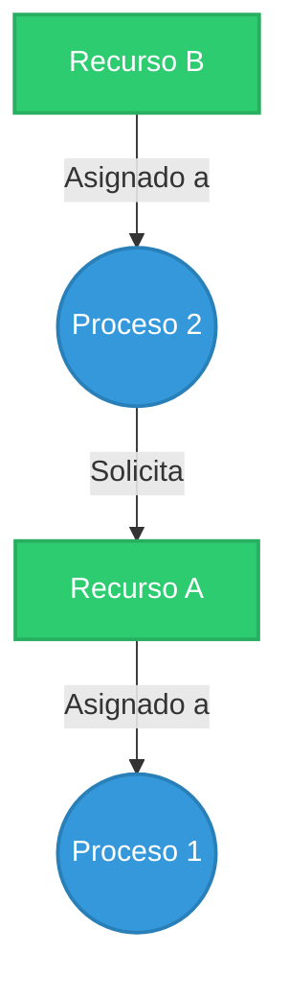
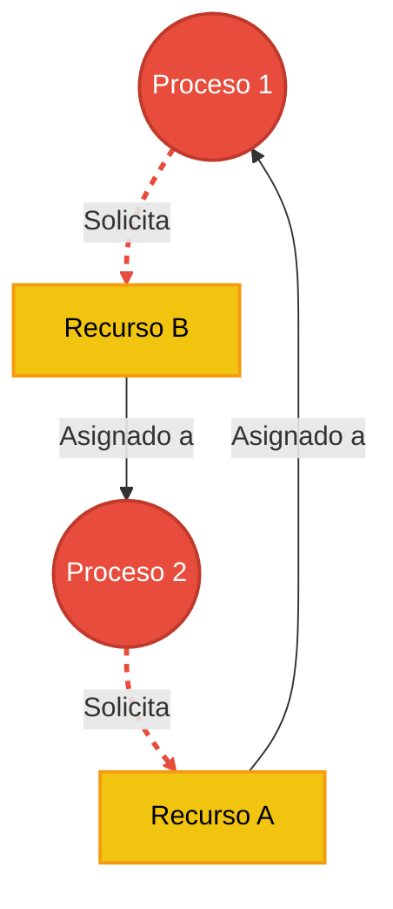

**Idea central:** Para detectar un interbloqueo matemáticamente antes de que congele el sistema, los Sistemas Operativos utilizan los Grafos de Asignación de Recursos (RAG, por sus siglas en inglés).

### Notación del Grafo

Un RAG es un mapa visual que muestra quién tiene qué, y quién está esperando qué. Utiliza una notación estandarizada:

*   **Procesos (Círculos):** Representan a los hilos o programas en ejecución.
*   **Recursos (Rectángulos):** Representan impresoras, memoria, archivos, o mutex. Un recurso puede tener varios "puntitos" adentro si tiene múltiples instancias (ej. 3 impresoras idénticas).
*   **Arista de Asignación (Recurso ➔ Proceso):** Una flecha que sale del rectángulo hacia el círculo significa *"El recurso está actualmente en uso por este proceso"*.
*   **Arista de Solicitud (Proceso ➔ Recurso):** Una flecha que sale del círculo hacia el rectángulo significa *"El proceso necesita este recurso y está esperando en la cola"*.

---

### La Regla Clave de los Ciclos

Para saber si hay un interbloqueo mirando un grafo, debes buscar si las flechas forman un círculo cerrado (un ciclo). La regla matemática es:

1.  **Ciclo con 1 instancia por recurso ➔ IMPLICA Interbloqueo seguro.** Si todos los recursos son únicos (como un Mutex), un ciclo es garantía 100% de que el sistema está muerto.
2.  **Ciclo con varias instancias ➔ NECESARIO pero NO suficiente.** Si hay recursos con múltiples instancias, encontrar un ciclo es una señal de alarma, pero puede que no haya deadlock si un proceso ajeno al ciclo libera una instancia a tiempo.

---

### Diagramas de Contraste (Mermaid)

Veamos la diferencia visual entre un sistema sano y uno colapsado usando diagramas de flujo.

#### 1. Sistema SANO (Sin Ciclos)

El Proceso 1 tiene el Recurso A. El Proceso 2 está esperando el Recurso A, pero ya tiene el Recurso B. Todo fluye, el Proceso 1 terminará eventualmente y liberará A.

#### 2. Sistema EN DEADLOCK (Ciclo detectado)

Aquí vemos el problema del código en C de la página anterior. Se forma un ciclo cerrado infinito: `P1 -> RB -> P2 -> RA -> P1`. Como los recursos tienen una sola instancia, esto es un interbloqueo irrecuperable.

*(Las flechas punteadas rojas muestran el momento en que se cierra el ciclo fatal).*