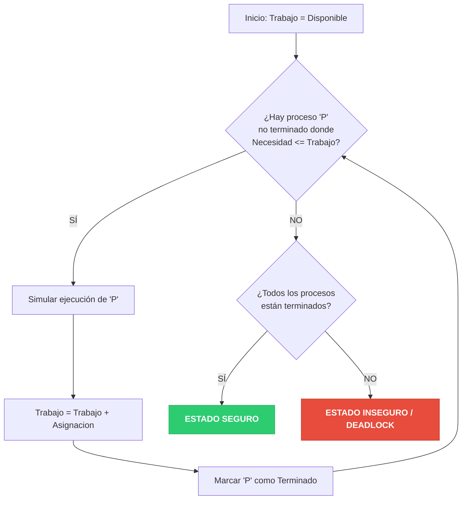

**Idea central:** Creado por Edsger Dijkstra, es el método clásico de **Evitación**. Funciona como un banco: nunca aprueba un préstamo de recursos a menos que esté seguro de que el cliente (proceso) podrá terminar su trabajo y devolver el préstamo.

### Conceptos Clave: Matrices y Estados

El algoritmo divide la situación del sistema en dos estados:
*   **Estado Seguro:** Existe al menos una secuencia matemática donde todos los procesos pueden terminar su ejecución sin entrar en interbloqueo[cite: 24].
*   **Estado Inseguro:** No hay garantía. Puede que no ocurra un deadlock inmediatamente, pero el sistema está en riesgo[cite: 24].

Para saber en qué estado estamos, el Banquero mantiene 4 estructuras de datos[cite: 24]:
1.  **`Disponible`**: Vector que indica cuántas instancias libres quedan de cada recurso.
2.  **`Máximo`**: Matriz donde cada proceso declara el máximo de recursos que llegará a pedir.
3.  **`Asignación`**: Matriz de lo que cada proceso ya tiene retenido en este momento.
4.  **`Necesidad`**: Matriz calculada dinámicamente: `Necesidad = Máximo - Asignación`[cite: 24].

### Ejemplo Resuelto Paso a Paso

Supongamos un sistema con 5 procesos (P0 a P4) y 3 tipos de recursos (A, B, C)[cite: 24]. 
*   **Total de recursos en el sistema:** A=10, B=5, C=7.

En un momento "T0", la situación es la siguiente:

| Proceso | `Asignación` (A B C) | `Máximo` (A B C) | `Necesidad` (A B C)[cite: 24] |
| :--- | :--- | :--- | :--- |
| **P0** | 0  1  0 | 7  5  3 | 7  4  3 |
| **P1** | 2  0  0 | 3  2  2 | 1  2  2 |
| **P2** | 3  0  2 | 9  0  2 | 6  0  0 |
| **P3** | 2  1  1 | 2  2  2 | 0  1  1 |
| **P4** | 0  0  2 | 4  3  3 | 4  3  1 |

*Suma de Asignaciones:* (7, 2, 5).
*Vector `Disponible` inicial:* Total (10, 5, 7) - Asignados (7, 2, 5) = **(3, 3, 2)**[cite: 24].

#### Buscando la Secuencia Segura (El vector `Trabajo`)

Iniciamos nuestro vector de `Trabajo` igual al `Disponible` **(3, 3, 2)**. Buscamos un proceso cuya `Necesidad <= Trabajo`[cite: 24].

1.  **P0:** Necesita (7,4,3). No alcanza con (3,3,2). Pasa turno.
2.  **P1:** Necesita (1,2,2). `(1,2,2) <= (3,3,2)` ¡Sí alcanza!
    *   *Simulamos que P1 termina.* Devuelve su Asignación (2,0,0).
    *   Nuevo `Trabajo` = (3,3,2) + (2,0,0) = **(5, 3, 2)**[cite: 24].
3.  **P3:** Necesita (0,1,1). `(0,1,1) <= (5,3,2)` ¡Sí alcanza!
    *   *P3 termina.* Devuelve (2,1,1).
    *   Nuevo `Trabajo` = (5,3,2) + (2,1,1) = **(7, 4, 3)**[cite: 24].
4.  **P0:** Revisamos de nuevo. Necesita (7,4,3). `(7,4,3) <= (7,4,3)` ¡Ahora sí alcanza!
    *   *P0 termina.* Devuelve (0,1,0).
    *   Nuevo `Trabajo` = (7,4,3) + (0,1,0) = **(7, 5, 3)**[cite: 24].
5.  **P2:** Necesita (6,0,0). `(6,0,0) <= (7,5,3)` ¡Sí alcanza!
    *   *P2 termina.* Devuelve (3,0,2).
    *   Nuevo `Trabajo` = (7,5,3) + (3,0,2) = **(10, 5, 5)**[cite: 24].
6.  **P4:** Necesita (4,3,1). `(4,3,1) <= (10,5,5)` ¡Sí alcanza!
    *   *P4 termina.* Devuelve (0,0,2).
    *   Nuevo `Trabajo` = (10,5,5) + (0,0,2) = **(10, 5, 7)**[cite: 24].

Hemos procesado todos. **El Estado es Seguro y la secuencia es: `<P1, P3, P0, P2, P4>`**[cite: 24].

### Diagrama de Flujo del Algoritmo de Seguridad



### Script en Python para Validación (20 líneas)

Puedes guardar este código en un archivo `banquero.py` y ejecutarlo para comprobar matemáticamente la resolución manual que hicimos arriba[cite: 24].

```python
import numpy as np

asignacion = np.array([[0,1,0], [2,0,0], [3,0,2], [2,1,1], [0,0,2]])
maximo = np.array([[7,5,3], [3,2,2], [9,0,2], [2,2,2], [4,3,3]])
disponible = np.array([3,3,2])
necesidad = maximo - asignacion
n_procesos = len(asignacion)
terminado = [False] * n_procesos
secuencia = []
trabajo = disponible.copy()

while len(secuencia) < n_procesos:
    hubo_asignacion = False
    for p in range(n_procesos):
        if not terminado[p] and all(necesidad[p] <= trabajo):
            trabajo += asignacion[p]
            terminado[p] = True
            secuencia.append(f"P{p}")
            hubo_asignacion = True
            print(f"P{p} ejecuta. Nuevo Trabajo: {trabajo}")
    if not hubo_asignacion:
        print("Estado Inseguro detectado.")
        break

if len(secuencia) == n_procesos:
    print(f"Estado Seguro. Secuencia: {' -> '.join(secuencia)}")
```