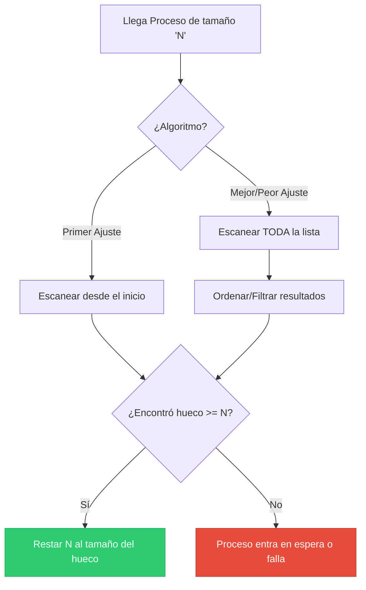

**Idea central:** Antes de la invención de la paginación, el Sistema Operativo debía cargar el código de un programa completo en un solo bloque continuo de memoria (asignación contigua).

### Particiones Fijas vs Variables

*   **Particiones Fijas:** La memoria se divide en bloques de tamaño predeterminado al arrancar el sistema (ej. bloques de 100MB). **Problema:** Fragmentación interna. Si un programa pesa 2MB y se le asigna un bloque de 100MB, se desperdician 98MB.
*   **Particiones Variables:** El Sistema Operativo crea un bloque (hueco) del tamaño exacto que pide el programa[cite: 30]. **Problema:** Fragmentación externa. A medida que los programas entran y salen, dejan huecos vacíos desperdigados por la RAM que son demasiado pequeños para ser usados por programas nuevos.

### Algoritmos de Ajuste (Asignación)

Cuando llega un proceso nuevo y hay múltiples huecos libres, el SO debe decidir dónde colocarlo[cite: 30].

| Algoritmo | ¿Cómo elige? | Velocidad | Fragmentación | ¿Cuándo conviene? |
| :--- | :--- | :--- | :--- | :--- |
| **Primer Ajuste** (First Fit) | Asigna el *primer* hueco que encuentre que sea suficientemente grande[cite: 30]. | **Rápido** | Alta (externa). Tiende a llenar el inicio de la memoria. | Para sistemas que necesitan respuestas en tiempo real[cite: 30]. |
| **Mejor Ajuste** (Best Fit) | Revisa *todos* los huecos y elige el que deje el sobrante más pequeño[cite: 30]. | **Lento** | Produce huecos diminutos inútiles. | Cuando la memoria es muy escasa y debe optimizarse al máximo[cite: 30]. |
| **Peor Ajuste** (Worst Fit) | Revisa *todos* y elige el hueco *más grande* disponible[cite: 30]. | **Lento** | Fragmentación moderada. | Cuando se espera que los huecos sobrantes sean usados por otros procesos grandes[cite: 30]. |

---

### Ejercicio Resuelto: Cuando un algoritmo falla y otro no

Vamos a demostrar matemáticamente por qué la elección del algoritmo es crítica. 
Tenemos **5 huecos libres** en la memoria en este orden exacto: `[200, 150, 300, 50, 100]` MB[cite: 30].
Llegan **4 procesos** en este orden: `P1 (140 MB)`, `P2 (180 MB)`, `P3 (250 MB)`, `P4 (90 MB)`[cite: 30].

#### Escenario A: Primer Ajuste (First Fit) - ❌ FALLO
1.  **P1 (140):** Toma el primer hueco que le sirve (200). Sobran 60. `Estado: [60, 150, 300, 50, 100]`
2.  **P2 (180):** El primer hueco que le sirve es 300. Sobran 120. `Estado: [60, 150, 120, 50, 100]`
3.  **P3 (250):** Revisa la lista... `60 (No) -> 150 (No) -> 120 (No) -> 50 (No) -> 100 (No)`. **¡Fallo de memoria!** P3 se queda sin lugar a pesar de que el total de memoria libre es 480 MB (Fragmentación Externa)[cite: 30].

#### Escenario B: Mejor Ajuste (Best Fit) - ✅ ÉXITO
1.  **P1 (140):** El ajuste perfecto es el hueco de 150. Sobran 10. `Estado: [200, 10, 300, 50, 100]`
2.  **P2 (180):** El ajuste perfecto es el hueco de 200. Sobran 20. `Estado: [20, 10, 300, 50, 100]`
3.  **P3 (250):** El único que sirve es 300. Sobran 50. `Estado: [20, 10, 50, 50, 100]`
4.  **P4 (90):** El ajuste perfecto es el hueco de 100. Sobran 10. `Estado: [20, 10, 50, 50, 10]`
*Todos los procesos fueron asignados exitosamente.*[cite: 30]

---

### Script de Validación en Python

Puedes ejecutar este script de menos de 20 líneas para validar matemáticamente cualquier otro escenario[cite: 30].

```python
def asignar_memoria(huecos_iniciales, procesos, algoritmo):
    mem = list(huecos_iniciales)
    print(f"\n--- Probando algoritmo: {algoritmo.upper()} ---")
    for p in procesos:
        idx = -1
        if algoritmo == 'primer':
            idx = next((i for i, h in enumerate(mem) if h >= p), -1)
        elif algoritmo == 'mejor':
            validos = [i for i, h in enumerate(mem) if h >= p]
            idx = min(validos, key=lambda i: mem[i]) if validos else -1
        elif algoritmo == 'peor':
            validos = [i for i, h in enumerate(mem) if h >= p]
            idx = max(validos, key=lambda i: mem[i]) if validos else -1
        
        if idx != -1:
            mem[idx] -= p
            print(f"P({p}) asignado al hueco {idx}. Memoria restante: {mem}")
        else:
            print(f"P({p}) -> FALLO. No hay hueco suficiente.")

huecos = [200, 150, 300, 50, 100]
procesos = [140, 180, 250, 90]
asignar_memoria(huecos, procesos, 'primer')
asignar_memoria(huecos, procesos, 'mejor')
```

### Diagrama de Decisión de Asignación

